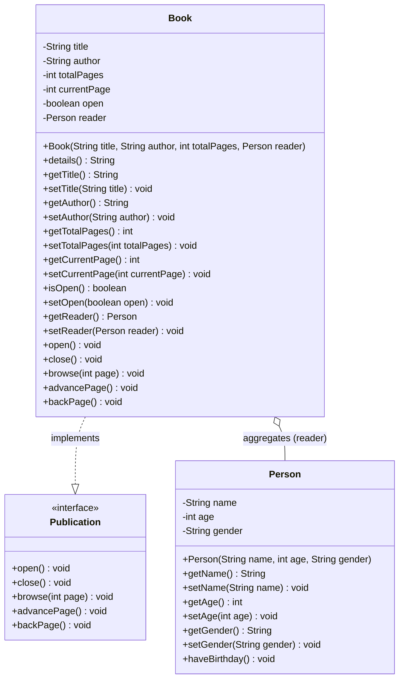

# TECHNICAL DOCUMENTATION AND OOP ARCHITECTURE

Academic project developed for the **Object-Oriented Programming (OOP) Practical Assignment - Stage 1**.

---

## 1. Class Diagram (UML)

---

## 2. Core OOP Concepts Applied

1. **Abstraction:** Extraction of essential domain attributes for `Person` and `Book`.
2. **Strict Encapsulation:** All attributes declared `private` with controlled access via Getters and Setters (`JavaBeans` standard).
3. **Aggregation:** Association between `Book` and `Person` (`reader: Person`), with independent lifecycles.
4. **Interfaces and Polymorphism:** `Publication` interface formalizing navigation behaviors implemented by `Book`.
5. **Business Rules and Boundaries:**
   - A book is always instantiated closed (`open = false`) on page 0 (`currentPage = 0`).
   - If attempting to turn pages beyond total capacity ($page > totalPages$), current page is reset to `0` (Slide 37 rule).
